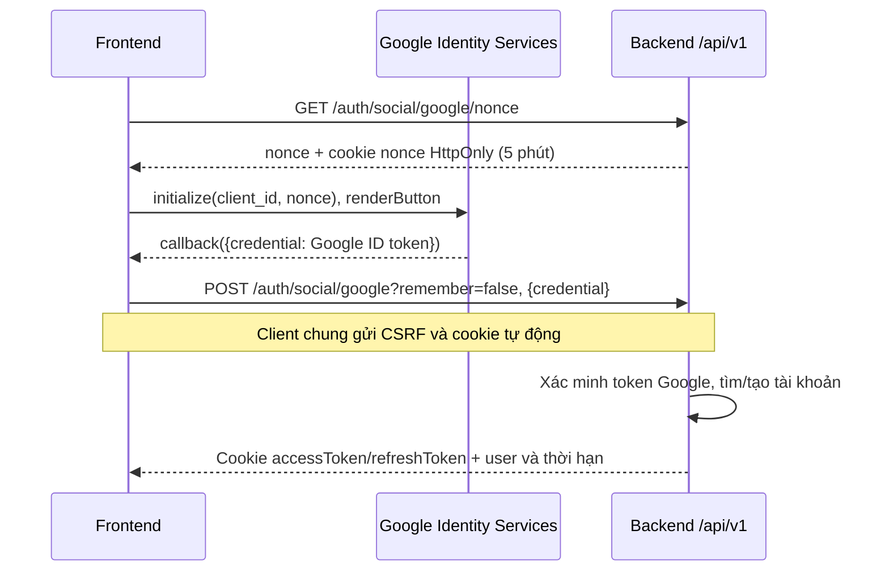

# Kết nối Google Auth với NUTEE

Frontend đã có nút Google và backend đã có API xác minh Google ID token.
Bạn chỉ cần tạo OAuth Web Client ID và điền cấu hình. Hiện cấu hình được giữ
`GOOGLE_AUTH_ENABLED=false`, Client ID để trống theo yêu cầu; tài liệu này không tự bật Google.

## 1. Tạo Client ID

1. Mở [Google Cloud Console](https://console.cloud.google.com/), tạo hoặc chọn project.
2. Vào **Google Auth Platform → Branding**, điền tên ứng dụng, email hỗ trợ và thông tin liên hệ.
3. Trong **Audience**, chọn đối tượng phù hợp; dùng External nếu thử với Gmail cá nhân.
4. Vào **Clients → Create client → Web application**.
5. Thêm **Authorized JavaScript origins** cho môi trường local:

   ```text
   http://localhost
   http://localhost:5173
   ```

6. Sao chép **Client ID** dạng `123456789-xxx.apps.googleusercontent.com`.

Origin chỉ gồm giao thức, host và cổng, không chứa `/login` hay `/api/v1`.
Luồng hiện tại nhận credential qua JavaScript callback, nên không cần thêm redirect URI.
Xem [hướng dẫn cấu hình chính thức](https://developers.google.com/identity/gsi/web/guides/get-google-api-clientid).

Nếu dùng cổng khác, thêm origin tương ứng và mở frontend bằng đúng địa chỉ đó.
Với Audience giới hạn hoặc chế độ thử nghiệm, kiểm tra tài khoản thử được phép trong Console;
không chọn Internal nếu cần đăng nhập từ ngoài tổ chức.

## 2. Điền cấu hình trong hai ứng dụng

Sửa các dòng sau trong **`backend/.env` đang có**; giữ các cấu hình DB và JWT hiện tại:

```dotenv
GOOGLE_AUTH_ENABLED=true
GOOGLE_CLIENT_ID=123456789-xxx.apps.googleusercontent.com
AUTH_SECURE_COOKIE=false
AUTH_COOKIE_SAME_SITE=Lax
CORS_ALLOWED_ORIGINS=http://localhost:5173
```

`AUTH_SECURE_COOKIE=false` chỉ dùng cho HTTP local. Nếu đang cần origin khác trong CORS,
giữ chúng trong danh sách phân cách bằng dấu phẩy.

Tạo hoặc sửa **`frontend/.env.local`**:

```dotenv
VITE_API_BASE_URL=/api/v1
VITE_GOOGLE_CLIENT_ID=123456789-xxx.apps.googleusercontent.com
```

Hai Client ID phải giống nhau. Dự án chỉ dùng Google Identity Services để xác thực;
cấu hình không yêu cầu Google API key, client secret hay quyền đọc Gmail/Drive.
Client ID là định danh công khai; các bí mật DB/JWT/SMTP vẫn chỉ nằm ở backend.

Khởi động lại backend từ thư mục `backend`:

```powershell
.\scripts\run-local.ps1
```

Script đọc `.env`. Nếu chạy từ IDE, phải nạp biến môi trường tương ứng; Spring không tự đọc file này.
Khởi động lại Vite từ thư mục `frontend`:

```powershell
npm.cmd run dev
```

Mở `http://localhost:5173/login`. Vite đã proxy `/api/v1` tới `http://localhost:8080`.
Không cần bật gửi email để thử Google Auth; giữ `PASSWORD_RESET_ENABLED=false` nếu chưa cấu hình SMTP.

## 3. Luồng đăng nhập trong code hiện tại



- UI/SDK: `frontend/src/modules/auth/components/GoogleSignIn.tsx`.
- API frontend: `frontend/src/modules/auth/api/authService.ts`.
- Cookie, CSRF, refresh: `frontend/src/shared/api/apiClient.ts`.
- API backend: `auth/controller/SocialLoginController.java`.
- Strategy xác minh: `auth/service/GoogleTokenVerifier.java`.
- Tìm/tạo/liên kết tài khoản: `auth/service/AuthService.java`.

Backend kiểm tra chữ ký Google, issuer, Client ID trong audience, thời hạn, email đã xác minh
và nonce khớp cookie. Danh tính liên kết dùng `GOOGLE` + `sub`, không dùng email làm ID provider.
Việc bỏ issuer/audience ở JWT nội bộ NUTEE không áp dụng cho Google ID token.
Các kiểm tra Google dựa trên [hướng dẫn xác minh ID token](https://developers.google.com/identity/gsi/web/guides/verify-google-id-token).

Frontend gửi Google credential **một lần để đổi lấy phiên NUTEE**. Các request tiếp theo dùng
JWT NUTEE trong cookie HttpOnly, không gửi lại credential hoặc access/refresh token trong body.
Client gọi `GET /api/v1/auth/csrf` trước request thay đổi dữ liệu và gửi header trả về;
không đọc JWT hoặc CSRF cookie bằng JavaScript.

## 4. Liên kết với tài khoản email đã có

Google login xử lý theo các trường hợp:

| Tình trạng tài khoản | Kết quả |
| --- | --- |
| Google `sub` đã được liên kết | Đăng nhập tài khoản đó |
| Email chưa tồn tại | Tạo CUSTOMER rồi đăng nhập |
| Email đã tồn tại nhưng chưa liên kết Google | `409`; cần đăng nhập tài khoản đó trước để liên kết |

Backend đã có API liên kết. Frontend hiện chưa có nút liên kết trong trang tài khoản.
Khi thêm giao diện này, dùng luồng sau:

1. Đăng nhập bằng email/mật khẩu vào tài khoản NUTEE cần liên kết.
2. Lấy **nonce mới**, khởi tạo GIS với nonce đó và để người dùng chọn Google cùng email.
3. Trong callback GIS, gửi credential tới API link qua client chung:

   ```typescript
   import { api } from "@/app/services";

   // Chạy sau khi GIS đã tải, dùng nonce này cho lần xác thực Google mới.
   const { nonce } = await api.request<{ nonce: string }>(
     "/auth/social/google/nonce",
     { authenticated: false },
   );
   // Truyền nonce vào google.accounts.id.initialize({ client_id, nonce, callback }).
   // Trong callback({ credential }), gọi:
   async function linkGoogle(credential: string) {
     return api.request("/auth/social/google/link", {
       method: "POST",
       body: { credential },
     });
   }
   ```

4. API trả `200` kèm user. Sau đó có thể đăng xuất và đăng nhập lại bằng Google.

Đường dẫn đầy đủ là `POST /api/v1/auth/social/google/link`. API cần cookie đăng nhập,
CSRF và nonce mới; không tái sử dụng credential/nonce đã gửi cho login.
Email phải trùng tài khoản đang đăng nhập. Google identity đang thuộc tài khoản khác sẽ bị từ chối.
Hệ thống không tự gộp tài khoản chỉ vì email trùng nhau.

Thông số `client_id`, `nonce`, `callback` và `credential` được mô tả trong
[Google Identity Services JavaScript API](https://developers.google.com/identity/gsi/web/reference/js-reference).

## 5. Kiểm tra và xử lý lỗi

Sau khi cấu hình, dùng tài khoản Google có email chưa có trong NUTEE để thử login,
kiểm tra `/api/v1/auth/me` trả đúng user; logout rồi login lại phải giữ nguyên user ID.
Thử trường hợp email đã đăng ký bằng mật khẩu: Google login phải trả `409` trước khi liên kết.
Trong DevTools → Network/Application, JWT nằm ở cookie HttpOnly, không có trong JSON hay localStorage.
Không sao chép token thật vào log, tài liệu hoặc Git.

| Hiện tượng | Kiểm tra |
| --- | --- |
| Nút Google chưa khả dụng | `VITE_GOOGLE_CLIENT_ID` đang trống; điền và restart Vite |
| `503` từ API nonce/login | Backend còn `GOOGLE_AUTH_ENABLED=false`; kiểm tra biến được nạp và restart |
| Origin không được phép | So sánh địa chỉ trên trình duyệt với Authorized JavaScript origins, cả cổng |
| `401` khi gửi credential | Client ID hai bên phải trùng; kiểm tra nonce mới, cookie và đồng hồ máy |
| Nonce hết hạn hoặc đã dùng | Lấy nonce mới và thực hiện lại bước chọn tài khoản Google |
| `403`, `CSRF_INVALID` | Gọi bằng client chung; kiểm tra `/auth/csrf`, header và cookie được gửi |
| `409` | Email có sẵn cần liên kết; hoặc identity/email liên kết không phù hợp |
| Login xong `/me` vẫn `401` | Kiểm tra cookie; HTTP local dùng `AUTH_SECURE_COOKIE=false`, thống nhất hostname |
| Google từ chối tài khoản | Kiểm tra Audience, giới hạn tổ chức và quyền của tài khoản trong Console |

Khi triển khai, ưu tiên cùng origin: HTTPS cho frontend và reverse proxy `/api/v1` về backend.
Đặt `AUTH_SECURE_COOKIE=true`, thêm đúng origin HTTPS vào Google Console và CORS, điền Client ID
của môi trường đó rồi build lại frontend. Cấu hình mặc định `SameSite=Lax` phù hợp với cùng site;
đừng chuyển frontend/API sang hai site độc lập mà không điều chỉnh chính sách cookie.
