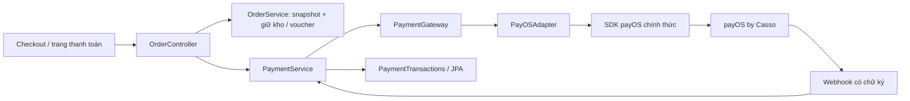

# Đặt hàng và thanh toán payOS by Casso

Nghiệp vụ phụ thuộc `PaymentGateway` (target); `PayOSAdapter` chuyển kiểu nội bộ sang SDK
`vn.payos:payos-java:2.0.1` (adaptee). SDK chỉ được import trong adapter. `PaymentService`
gọi mạng ngoài transaction; `PaymentTransactions` giữ các transaction ngắn và khóa DB.



Đọc đối chiếu [API payOS](https://payos.vn/docs/api/),
[Java SDK](https://payos.vn/docs/sdks/back-end/java/),
[quy tắc chữ ký](https://payos.vn/docs/tich-hop-webhook/kiem-tra-du-lieu-voi-signature/)
và [payload webhook](https://payos.vn/docs/du-lieu-tra-ve/webhook/).
Đây là thanh toán qua payOS by Casso, không phải webhook biến động tài khoản độc lập của Casso.

## Cấu hình

Cấu hình payOS ở `app.payment` trong `src/main/resources/application.yml`,
không lưu cấu hình trong database. Các khóa YAML đọc secret từ biến môi trường;
có thể đặt giá trị môi trường trong backend `.env` local (không commit):

```dotenv
PAYOS_ENABLED=true
PAYOS_CLIENT_ID=
PAYOS_API_KEY=
PAYOS_CHECKSUM_KEY=
PAYMENT_FRONTEND_URL=https://shop.example.com
CHECKOUT_SHIPPING_FEE=25000
PAYMENT_EXPIRY_MINUTES=15
```

Chỉ bật sau khi đã điền ba khóa thật. Không gửi khóa ra frontend. `PAYOS_ENABLED=false`
là mặc định; COD vẫn dùng được, QR trả 503 rõ ràng. Bật mà thiếu khóa sẽ fail startup.
`app.payment.shipping-fee` trong `application.yml` dùng `${CHECKOUT_SHIPPING_FEE:25000}`:
mặc định 25.000đ, có thể đổi bằng env hoặc giá trị mặc định trong YAML. Phí được chụp vào
đơn khi tạo; đổi cấu hình không sửa đơn cũ. Promotion giảm giá sản phẩm trước, voucher giảm
tiếp tiền hàng, phí giao hàng cộng sau cùng. Thời hạn QR cho phép 5–60 phút, mặc định 15.

`PAYMENT_FRONTEND_URL` phải là URL HTTPS tin cậy; localhost HTTP được hỗ trợ lúc phát triển.
Return/cancel URL đều quay về `/orders/{id}/payment`; tham số trình duyệt không xác nhận tiền.

Trên kênh payOS, đăng ký Webhook URL công khai HTTPS:

```text
https://api.example.com/api/v1/payments/payos/webhook
```

Khi dùng reverse proxy cùng origin, URL là `https://shop.example.com/api/v1/payments/payos/webhook`.
Local cần tunnel HTTPS tới backend, không trỏ tới trang frontend. Không tự gọi đăng ký webhook
hoặc tạo giao dịch thật khi chưa có credential và URL công khai. Chỉ đúng POST trên đường dẫn
này được miễn JWT/CSRF; HMAC do SDK xác minh. Giữ giới hạn request tại ingress (ví dụ 64 KB).
Dùng kênh merchant riêng cho từng môi trường; giữ nguyên sequence mã payOS khi có lịch sử thanh toán.

## API khách hàng

Tất cả endpoint dưới đây yêu cầu cookie phiên hiện tại, POST dùng CSRF client chung:

| Method | Endpoint dưới `/api/v1` | Kết quả |
| --- | --- | --- |
| GET | `/checkout/config` | `shippingFee`, `payosEnabled` |
| POST | `/checkout/quote` | Giá tiền hàng sau promotion/voucher, chưa có phí giao |
| POST | `/orders` | 201 snapshot đơn; QR tự tạo phiên payOS, trả `payment.qrCode`; retry cùng khóa/nội dung trả lại đúng đơn |
| GET | `/orders?page=0&size=20&status=all&q=` | Lịch sử chính chủ, lọc/phân trang trong DB |
| GET | `/orders/{id}` | Snapshot đơn chính chủ |
| POST | `/orders/{id}/payment` | Tạo/khôi phục link payOS với mã ổn định |
| GET | `/orders/{id}/payment` | Trạng thái đã lưu, `qrCode`, hạn thanh toán; chỉ chủ đơn |
| POST | `/orders/{id}/payment/refresh` | Đối soát API payOS; hết hạn thì yêu cầu hủy |
| POST | `/orders/{id}/cancel` | COD hủy nội bộ; QR chờ kết quả thật từ payOS |

Ví dụ tạo đơn:

```json
{
    "idempotencyKey": "91836e08-8f73-4b0e-9d2d-b9285b13be2a",
    "variantIds": [11],
    "voucherCode": "",
    "expectedTotal": 10025000,
    "addressId": 1,
    "note": "",
    "paymentMethod": "qr"
}
```

Số lượng luôn đọc từ giỏ chính chủ; giá/khuyến mãi đọc từ backend. `expectedTotal` là điều
kiện xác nhận, không phải giá được tin cậy: khác báo giá + phí giao hiện tại trả 409.
Một transaction khóa khách, kiểm tra địa chỉ thuộc khách, khóa voucher và variants;
lưu khóa địa chỉ hiện có `orders.user_address_id`, snapshot giá gốc/giá sau promotion,
khoản giảm, phí, tổng; giữ kho và quota rồi xóa dòng giỏ đã mua. Tên và số điện thoại
lấy từ user, không nhận dữ liệu liên hệ hay địa chỉ tự do từ client.
Response có `addressId`, `recipient`, `phone`, `addressLine`; ba trường hiển thị cuối
được đọc từ user/địa chỉ hiện tại nên thay đổi theo hồ sơ/sổ địa chỉ.
Đơn không thu tiền (tổng 0) được xác nhận nội bộ, không tạo yêu cầu thu 0đ.
Với QR, backend gọi payOS sau khi transaction tạo đơn hoàn tất, rồi trả `payment.qrCode`.
Frontend vẽ VietQR trực tiếp trong checkout; không gửi nội dung mã qua dịch vụ bên thứ ba.
Nếu payOS lỗi, response vẫn trả đơn đã tạo cùng `paymentError`; thử lại ở
`POST /orders/{id}/payment` và giữ nguyên mã phiên, không tạo đơn mới.

## Webhook và đối soát

`POST /api/v1/payments/payos/webhook` nhận envelope JSON theo tài liệu payOS.
SDK kiểm tra HMAC trên `data`; chỉ `data.code="00"` đã ký được xét thành công.
Backend đối chiếu mã payOS, paymentLinkId nếu đã biết, số tiền chính xác và VND.
Outer `success`, query `status=paid` hay `payment=paid` không đổi trạng thái.

- `orders`: giữ trạng thái thanh toán, mã payOS ổn định, `checkout_url`, `qr_code`,
  `bank_bin`, `account_number`, `account_name`, `transfer_content` và số lần tạo.
  Nội dung gửi payOS khi tạo QR mới là `orders.order_code`. Khóa đơn và trạng thái
  `creating` trong 30 giây ngăn tạo đồng thời; số lần tạo ngăn phản hồi cũ ghi đè lần mới.
  Không giữ transaction khi gọi provider, không cần lease token hoặc bảng phiên riêng.
  SDK timeout 10 giây, không tự retry mạng;
  create lỗi sẽ đọc lại đúng mã để đối soát. API đọc thông tin payOS không trả lại
  `qrCode`; nếu response tạo link bị mất và chưa kịp lưu QR, không tự suy đoán
  mã hoặc tạo phiên khác. Giao diện yêu cầu liên hệ cửa hàng để đối soát.
- `transaction_logs`: mỗi lần nhận webhook đã xác minh có một dòng, kể cả callback lặp.
  Callback lặp cùng dữ liệu được ACK 200; trạng thái `orders` dưới khóa dòng ngăn ghi nhận
  tiền lần hai. Reference trùng nhưng khác dữ liệu được ghi log và trả 409. Probe đã ký cho mã chưa biết
  được lưu `unknown_order` rồi ACK, không tạo đơn/đánh dấu tiền cho đơn khác.
- Sai chữ ký/payload: 400, không cập nhật tiền. Sai số tiền, tiền tệ, link: `review` và
  giữ kho để đối soát. Không tự gộp nhiều khoản thiếu tiền hoặc tự hoàn tiền.
- Webhook tới trước create response vẫn xác nhận được; response trễ không hạ trạng thái paid.
- Job mỗi 60 giây lấy tối đa 50 phiên chờ, đối soát từ API. Chỉ khi provider xác nhận
  `CANCELLED`/`EXPIRED` và chưa nhận tiền mới hoàn kho một lần và giải phóng quota voucher.
  QR hết hạn chưa từng gọi provider được hủy nội bộ dưới khóa đơn.
- Provider lỗi/không xác định: giữ tài nguyên, trả lỗi rõ ràng và thử đối soát lượt sau.
  Phiên lỗi mà provider liên tục không tìm thấy cần vận hành kiểm tra; không tự suy đoán
  rằng chưa nhận tiền để bán lại hàng. Tiền đến sau khi đã hoàn kho chuyển `review`,
  giữ đơn hủy để tránh giao hàng vượt kho. Nhân viên xử lý đối soát/hoàn tiền ngoài phạm vi này.

`transaction_logs.raw_body` lưu envelope webhook nguyên cấu trúc JSON, gồm `data`
và chữ ký; `request_header` lưu header HTTP dưới dạng JSON, loại cookie/token/API key.
Không dùng `raw_body` để chứa phản hồi tạo QR. Không đưa payload, header, QR hoặc
credential vào application log hay response cho khách. QR và tài khoản được lưu ở
`orders` để API thanh toán chính chủ trả lại `qrCode`, `bankBin`, `accountNumber`,
`accountName`, `transferContent`. GET trả trạng thái thực tế;
UI không thông báo hủy thành công nếu payOS vẫn đang chờ hoặc cần đối soát.

## Migration và kiểm chứng

Baseline V1–V3 được giữ nguyên; V4 chuyển thông tin thanh toán vào `orders`, log cũ
vào `transaction_logs`, rồi xóa `payment_events` và các cột lease/external ID.
Log phiên cũ giữ `status=legacy_session`; payload/header cũ không có thì giữ NULL.
QR cũ giữ nội dung thực tế đã biết, không đổi nhãn thành mã đơn khi QR vẫn chứa nội dung cũ.
V4 nâng cấp database baseline hiện có mà không reset. Bảng `orders` không có `inventory_released`;
trạng thái `cancelled` được kiểm tra dưới khóa dòng để tránh hoàn kho hai lần.
Schema này dành cho database rỗng; không tương thích trực tiếp với Flyway V1–V7 cũ.

`PayOSAdapterTest` dùng vector chữ ký công khai chính thức và kiểm tra payload giả mạo.
`PaymentIT` dùng PostgreSQL thật, SDK xác minh chữ ký thật; chỉ API mạng provider được mock.
Bao phủ snapshot, idempotency, stock/voucher race, webhook lặp/trùng reference, sai tiền/
tiền tệ/link, callback sớm, tiền đến muộn, lỗi provider, COD/hết hạn và đối soát mất webhook.
Frontend E2E dùng HTTP fixture riêng cho kiểm tra retry cùng nội dung, phí 25k, hosted link
và chống giả trạng thái bằng URL. Chưa thay thế kiểm chứng giao dịch thật trên kênh merchant.

## Kiểm tra merchant thật theo lựa chọn

Frontend đối soát một lần qua `POST /orders/{id}/payment/refresh` khi quay lại
từ payOS với `orderCode` và `id`. Các tham số redirect chỉ kích hoạt kiểm tra;
trạng thái thanh toán vẫn lấy từ backend. Lỗi đối soát được hiển thị để thử lại.

`PayOSLiveIT` chỉ chạy khi `PAYOS_LIVE_TEST_ENABLED=true`, với ba khóa trong môi trường.
Test tạo link 2.000đ, truy vấn số tiền/trạng thái, rồi hủy trong `finally` sau khi
tạo thành công. Không chuyển tiền và không ghi database local. Test mặc định bỏ qua
bài này để không tạo link bên ngoài trong mỗi lần build.

Từ thư mục backend, dùng Java 21:

```powershell
. .\scripts\local-environment.ps1
Import-NuteeLocalEnvironment -ProjectRoot (Get-Location).Path
$env:PAYOS_LIVE_TEST_ENABLED = 'true'
.\mvnw.cmd '-Dit.test=PayOSLiveIT' '-Dtest=PayOSAdapterTest' verify
Remove-Item Env:PAYOS_LIVE_TEST_ENABLED
```

Xem [báo cáo kiểm chứng ngày 31/10/2026](REPORT-2026-10-31.md) để biết kết quả,
phạm vi đã kiểm tra và đối chiếu database với draw.io.
