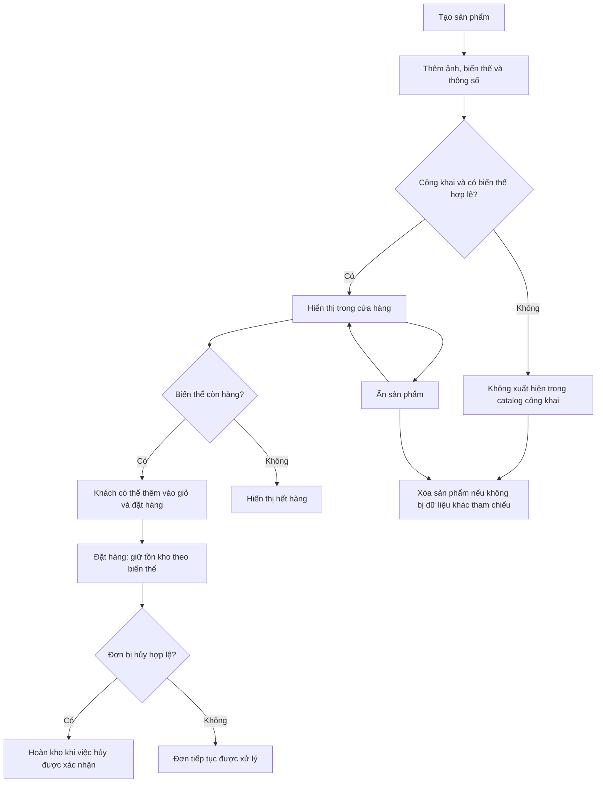

# Vòng đời sản phẩm NUTEE

Tài liệu này mô tả vòng đời của **một sản phẩm trong cửa hàng NUTEE** theo
giao diện quản trị và backend hiện tại: tạo sản phẩm, quản lý biến thể, công
khai, bán hàng, ẩn và xóa. Trạng thái đơn hàng và trạng thái thanh toán được
quản lý riêng, không phải trạng thái của sản phẩm.

## Tổng quan

Việc hết hàng không đồng nghĩa với ẩn sản phẩm. Một sản phẩm công khai có
biến thể hợp lệ với tồn kho bằng 0 vẫn có thể xuất hiện trong catalog, nhưng
khách không thể mua biến thể hết hàng.

## Vai trò và dữ liệu chính

- **Admin và staff đang hoạt động** được truy cập quản lý sản phẩm, biến thể,
  ảnh, thương hiệu và danh mục. Quyền được kiểm tra ở cả giao diện và backend.
- **Khách hàng** xem catalog công khai và mua bằng tài khoản khách hàng. Danh
  sách và chi tiết sản phẩm công khai không yêu cầu đăng nhập.
- `products` chứa tên, mô tả, trạng thái công khai, thương hiệu tùy chọn và
  khóa biến thể mặc định. Một sản phẩm có thể thuộc nhiều danh mục qua
  `product_categories`.
- `product_variants` chứa SKU, giá, tồn kho và ảnh tùy chọn của từng biến thể.
  `variant_specifications` lưu thông số theo từng biến thể; `product_images`
  lưu ảnh của sản phẩm.
- Trạng thái hiển thị được lưu bằng `products.is_published`. Trong giao diện
  quản trị, sản phẩm được hiển thị là **Công khai** hoặc **Đã ẩn**; không có
  trạng thái lưu riêng cho “hết hàng”.

## 1. Tạo và hoàn thiện sản phẩm

Trong cổng quản trị, vào **Sản phẩm → Thêm sản phẩm**, nhập tên, mô tả, thương
hiệu và danh mục nếu cần, chọn trạng thái công khai rồi lưu. Tên là bắt buộc;
thương hiệu và danh mục có thể để trống. Giao diện mặc định tạo sản phẩm ở
trạng thái ẩn và yêu cầu lưu sản phẩm trước khi thêm ảnh, biến thể.

Sau khi lưu:

1. Thêm ảnh bằng URL `http/https` hoặc đường dẫn bắt đầu bằng `/`. Có thể
   chọn ảnh chính; khi chọn ảnh khác làm ảnh chính, ảnh chính cũ được bỏ chọn.
2. Thêm từng biến thể với SKU, giá, tồn kho, ảnh tùy chọn và các cặp tên/giá
   trị thông số. SKU tối đa 16 ký tự và phải duy nhất; giá và số lượng là số
   nguyên không âm. Tên thông số trong cùng biến thể không được trùng.
3. Chọn biến thể mặc định nếu cần, sau đó lưu lại thông tin sản phẩm. Biến
   thể mặc định và ảnh gắn vào biến thể phải thuộc cùng sản phẩm.

Sản phẩm có thể được lưu hoặc đặt `published = true` trước khi có biến thể.
Tuy nhiên, catalog công khai chỉ hiển thị sản phẩm công khai khi có ít nhất
một biến thể hợp lệ với giá và tồn kho không âm. Biến thể hợp lệ có tồn kho
bằng 0 vẫn đáp ứng điều kiện hiển thị, nhưng không thể mua.

## 2. Công khai, chỉnh sửa và tồn kho

Chọn **Công khai sản phẩm** rồi lưu để sản phẩm đủ điều kiện xuất hiện trong
catalog. Bỏ chọn và lưu để ẩn. Sản phẩm ẩn vẫn có trong danh sách quản trị,
nhưng không được trả về bởi API catalog công khai và không thể được thêm vào
giỏ như sản phẩm đang bán.

Admin hoặc staff có thể sửa thông tin sản phẩm, ảnh, biến thể và thông số.
Khi sửa biến thể, API yêu cầu `expectedQuantity` là lượng tồn đã đọc trước
đó; nếu tồn kho thực tế đã thay đổi, API trả lỗi xung đột và cần tải lại
trước khi lưu. Việc này tránh ghi đè lượng tồn vừa thay đổi do đơn hàng hoặc
một thao tác khác.

Giá hiển thị ở catalog ưu tiên giá thấp nhất của các biến thể còn hàng; nếu
không còn biến thể nào có hàng, dùng giá thấp nhất của các biến thể hợp lệ.
Khuyến mãi sản phẩm đang có hiệu lực có thể làm giảm giá hiển thị và giá báo
cho khách, nhưng không thay đổi giá gốc lưu trên biến thể.

## 3. Thêm vào giỏ và đặt hàng

Khách chọn **biến thể**, không chỉ chọn sản phẩm gốc. Khi thêm vào giỏ hoặc
thay đổi số lượng, hệ thống kiểm tra sản phẩm công khai, giá và tồn kho hợp
lệ, cũng như số lượng yêu cầu không vượt tồn kho và giới hạn giỏ hàng. Dữ
liệu trong giỏ được kiểm tra lại khi báo giá/đặt hàng; giá hoặc tồn kho thay
đổi có thể khiến khách phải kiểm tra lại trước khi xác nhận.

Khi tạo đơn thành công, backend khóa các biến thể liên quan và trừ số lượng
đã đặt trong cùng giao dịch. Đơn lưu thông tin mặt hàng và giá tại thời điểm
mua; thay đổi sản phẩm về sau không phải là thao tác sửa giá của đơn đã tạo.
Đơn tham chiếu địa chỉ qua `orders.user_address_id`; tên và số điện thoại
được lấy từ thông tin người dùng.

Nếu đơn được hủy hợp lệ, hệ thống hoàn kho cho các biến thể của đơn. Với
payOS đã tạo liên kết, chỉ hoàn kho sau khi cổng thanh toán xác nhận hủy hoặc
hết hạn; khoản thanh toán đến muộn cần đối soát.

## 4. Ẩn, xóa và dữ liệu liên quan

**Ẩn** phù hợp khi tạm ngừng bán hoặc cần giữ sản phẩm và các liên kết hiện
có. Có thể công khai lại bằng cách chọn **Công khai sản phẩm** và lưu.

**Xóa** là xóa dữ liệu sản phẩm. Backend xóa thông số, biến thể và ảnh liên
quan trong cùng giao dịch. Nếu một ràng buộc dữ liệu đang tham chiếu đến sản
phẩm hoặc biến thể, chẳng hạn một dòng giỏ hàng hoặc đơn hàng, database từ
chối thao tác và giao dịch được hoàn tác. Không thể xóa biến thể đang được
chọn làm biến thể mặc định; cần đổi hoặc bỏ lựa chọn đó trước. Ảnh đang được
biến thể tham chiếu cũng không thể xóa cho đến khi bỏ liên kết.

Ẩn không tự hoàn kho và không tự hủy các đơn đã đặt. Việc xử lý đơn, thanh
toán, hủy đơn và lịch sử trạng thái là luồng riêng của đơn hàng.

## API liên quan

Các API quản trị dùng tiền tố `/api/v1/management/products`, yêu cầu phiên
admin/staff hợp lệ; thao tác ghi dùng CSRF theo cơ chế chung của ứng dụng.

| Phương thức và đường dẫn | Chức năng |
| --- | --- |
| `GET /` ; `GET /{id}` | Danh sách và chi tiết sản phẩm quản trị, gồm cả sản phẩm ẩn |
| `POST /` ; `PUT /{id}` ; `DELETE /{id}` | Tạo, cập nhật và xóa sản phẩm |
| `POST /{id}/variants` | Thêm biến thể |
| `PUT /{id}/variants/{variantId}` ; `DELETE /{id}/variants/{variantId}` | Sửa hoặc xóa biến thể |
| `POST /{id}/images` | Thêm ảnh |
| `PUT /{id}/images/{imageId}` ; `DELETE /{id}/images/{imageId}` | Sửa hoặc xóa ảnh |

Catalog công khai dùng `/api/v1/products` và `/api/v1/products/{id}`. Tài liệu
này mô tả hành vi được triển khai trong mã nguồn, không phải xác nhận rằng kiểm
thử tích hợp với PostgreSQL/payOS đã được chạy trong môi trường hiện tại.
